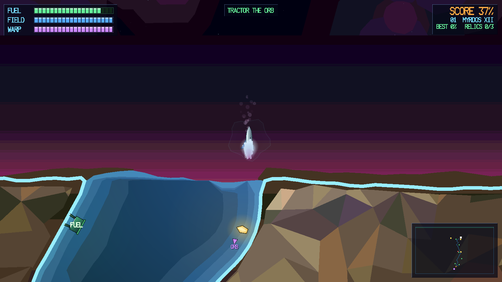

# zpilot

[](https://github.com/ZacWalk/zpilot/actions/workflows/build.yml)

A gravity-and-thrust cave flyer for Windows, in the spirit of Thrust and XPilot.
You fly a rocket through tunnels bored into a planet that has been cut in half,
hauling an orb on a chain that drapes, swings and whips.



*A frame from the deterministic gameplay capture.*

## The game

Gravity pulls, the rock does not move, and the only thing you spend is fuel —
for the engines that move you and the shield that pays for your mistakes.

- **Nothing counts down.** No timer; speed is worth nothing. The score is a live
  percentage of objectives banked, fuel left, shield integrity and relics found.
- **One ship per planet**, and retrying costs a single keypress.
- **35 planets in a 7×5 grid**, each a fixed seed. A row is a star system; the
  next unlocks once you clear four of seven.
- **Everything is a rigid body** — ship, orb, chain, drums, crates, boulders and
  propped shelves — so every hazard is also a tool.
- **No assets.** There are no textures, models, sprites, sound files or fonts:
  the rock, ships, props, glyphs, music and effects are all generated in code
  from a seed.
- **A 16-bit look at full resolution.** Everything is drawn in 2D in a
  twelve-bit palette: copper-banded skies and caverns, faceted rock, chrome
  lettering and crisp edges.

[docs/design.md](docs/design.md) explains why each of these holds.

## Controls

<kbd>W</kbd>/<kbd>S</kbd> drive and retro, <kbd>A</kbd>/<kbd>D</kbd> turn,
<kbd>Space</kbd> fires, <kbd>E</kbd> is the tractor beam, <kbd>Q</kbd>
overcharges the shield and <kbd>F</kbd> slows time. The arrow keys,
<kbd>Shift</kbd>, <kbd>Ctrl</kbd> and <kbd>Tab</kbd> do the same jobs (the
in-game manual shows that set), and the mouse buttons fire and tractor.

<kbd>R</kbd> restarts the planet, <kbd>P</kbd> pauses, <kbd>Esc</kbd> steps
back towards the star map, <kbd>F1</kbd> shows the manual, <kbd>F3</kbd> mutes,
<kbd>F11</kbd> toggles fullscreen and <kbd>F12</kbd> saves a screenshot.

## Building

Windows, C++20, Python 3.9+. Requires Visual Studio with the Desktop C++
workload; the vendored [dd](https://github.com/ZacWalk/dd) runtime locates it and
uses the CMake and Ninja that ship with it.

```powershell
.\dd.ps1 build                # both configurations
.\dd.ps1 test --label zpilot  # unit checks and the scripted capture, in both configurations
.\dd.ps1 test --label headless # the same gate, with genuinely hidden gameplay capture
.\dd.ps1 launch               # build Release, then start the game
```

The executable is `zpilot.exe`, in `build\release` or `build\debug`.

Both labels run the full three-act script through the game's real window and
renderer: 1,701 steps and frames, all 15 reference screenshots, mode/planet
checks and save-profile isolation. The explicit `--capture-headless` mode draws
into an offscreen native window that is never shown on a monitor or activated,
and prints its results to the console. `-capture` remains an interactive,
visible capture mode.
Each checked capture gets a fresh `build\<config>\captures\run-*\shots`
directory; previous captures are retained.

Test presets show passing output and the actual check/frame counts. After
building the updated executable, rerun with
`ctest --preset debug -L headless -V --no-tests=error` (or `release`).
The capture script redirects and drains both streams and awaits the GUI
executable; direct invocations must likewise be piped or explicitly awaited.

Progress is saved in `%APPDATA%\zpilot\profile.dat`. When that file does not
exist, the game reads `%APPDATA%\z-pilot\profile.dat` instead and leaves it
untouched; the next save goes to the `zpilot` folder. A `zpilot` profile always
takes precedence, even one that cannot be read. The scripted capture keeps its
own profile beside its screenshots and never reads or writes the player's.

### Procedural desktop icon

The build rasterises `tools\generate_icon.py` into its own generated ICO resource:
a continuous rocket hull, engine flame and chained orb. No artwork is checked in
or loaded beside the game. It uses Python's standard library and the vendored
`tools\iconlib.py`, with no font, graphics package or sibling import.
For a standalone export, run
`python tools\generate_icon.py --output tmp\zpilot.ico`; append `--check` to verify
it, or use `--output tmp\icon-128.png --size 128` for another size.

## Documentation

- [docs/design.md](docs/design.md) — what the player is meant to believe is
  happening, and the invariants the code must not break
- [AGENTS.md](AGENTS.md) — the gate, the traps and the conventions, for
  contributors and coding agents

## License

[MIT](LICENSE). The executable includes
[libdesktop](https://github.com/ZacWalk/libdesktop) and
[libfiles](https://github.com/ZacWalk/libfiles), which are licensed under the
Mozilla Public License 2.0: anyone distributing the executable must tell its
recipients where to get their source code, including any changes made to it.
`tools/iconlib.py` is vendored from libdesktop under the same licence.
